# Enamel

**Software for running a dental practice.** The appointment book, the
clinical record, the money, the letters and texts that go out to patients —
and a website patients can actually book from.

It is built on [Directus](https://directus.io), an open-source platform that
turns a database into an admin people can use. Enamel is what you have to add
around Directus to make it a real clinical system: the rules, the
permissions, the screens a dentist needs that a generic admin cannot give
them, and the work that happens in the background while nobody is watching.

> **This is a demonstration.** Every patient, appointment and record in it is
> invented. The photographs are synthetic — nobody in them is a real person.

---

## Contents

- [The four parts](#the-four-parts)
- [What it looks like](#what-it-looks-like)
- [The seven custom screens](#the-seven-custom-screens)
- [What the practice can do](#what-the-practice-can-do)
- [The work that happens in the background](#the-work-that-happens-in-the-background)
- [Letters, texts and email](#letters-texts-and-email)
- [Talking to the outside world](#talking-to-the-outside-world)
- [Looking after patients' data](#looking-after-patients-data)
- [Everything here is tested](#everything-here-is-tested)
- [By the numbers](#by-the-numbers)
- [Running it](#running-it)

---

## The four parts

Enamel is not one program. It is four, and they do different jobs.

### 1. The website — what the public sees

A normal dental practice website: treatments and what they cost, who works
there, opening hours, how to find the place. Nothing about it is hardcoded —
the practice writes all of it in the admin. Change the phone number, the
headline, a treatment price or the photographs, and the site changes.

There is no separate "content management system" to learn. The place the
receptionist looks up a patient is the same place the practice edits its own
website.

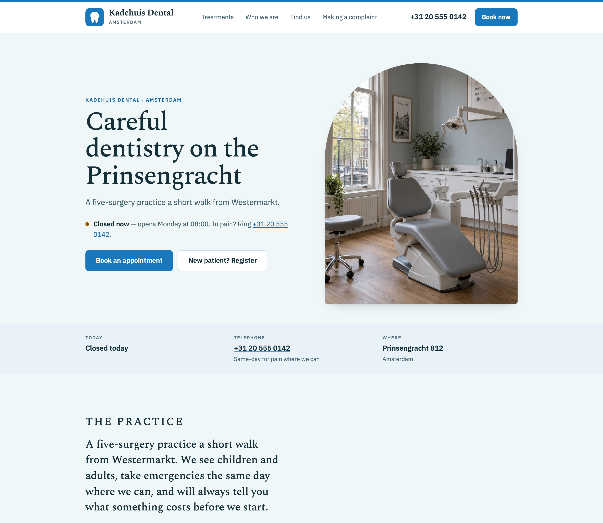

### 2. The patient area — booking, without ringing up

A patient signs in and sees their own record: their next appointment, what
they have had done, what they owe. They can book from the practice's **real**
availability — not a request form somebody phones back about, but the actual
diary, which knows the opening hours, which dentist is in that day, who is on
leave, and which chair is free.

A patient can only ever see their own record. That sounds obvious; most of
the testing in this project exists to prove it.

### 3. The admin — where the practice works

This is Directus, with a great deal added: a day sheet, a tooth chart, a
radiograph viewer, treatment plans, recalls, lab work, periodontal charting,
invoices and payments. The seven custom screens are described
[below](#the-seven-custom-screens).

The important part is who can see what. A receptionist needs the diary and
the bills; they do not need to read clinical notes, and here they cannot —
not by opening the record, not by asking the database directly, not by
guessing a web address.

### 4. The background work — the things nobody watches

Appointment reminders, confirmations, recall letters, payment chasers. These
cannot run inside a web page, because a web page only exists while somebody
is looking at it. They run in **queues**, described
[below](#the-work-that-happens-in-the-background).

---

## What it looks like

The sign-in screen. Branding, colours and the note are set in the admin, not
in code:

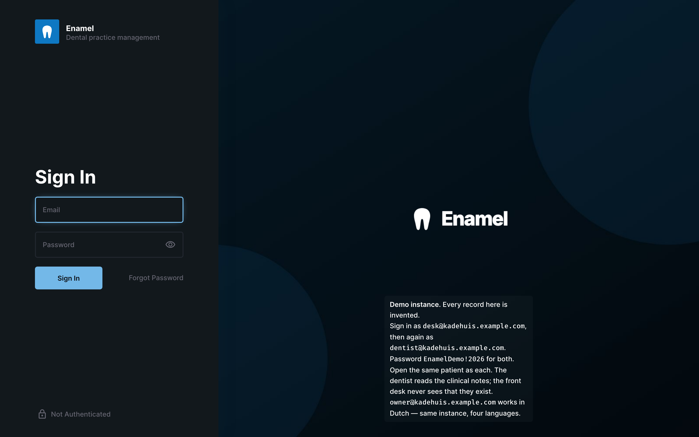

A patient record as the practice sees it:

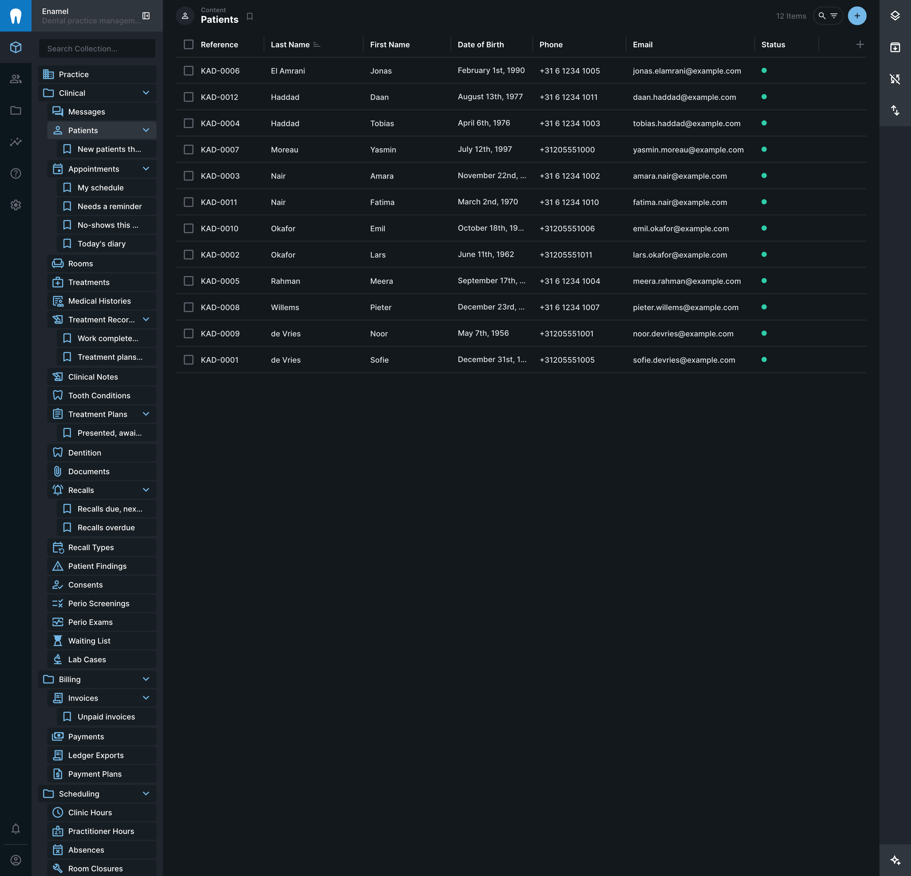

The tooth chart — click a tooth, record what was found or done:

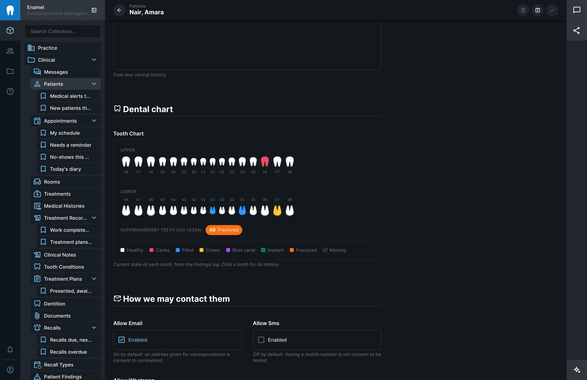

The same patient, opened by a receptionist and by a dentist. The difference
is the point of the whole project:

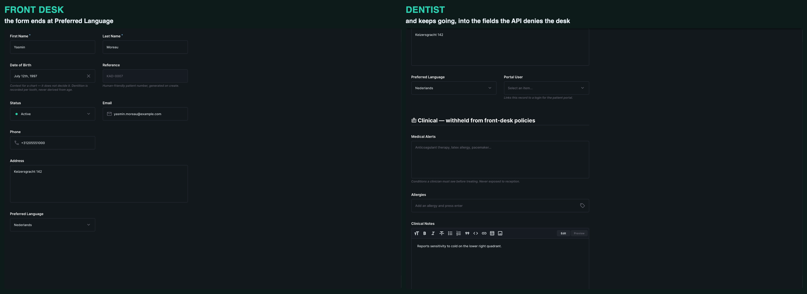

It speaks four languages. The same record in Dutch:

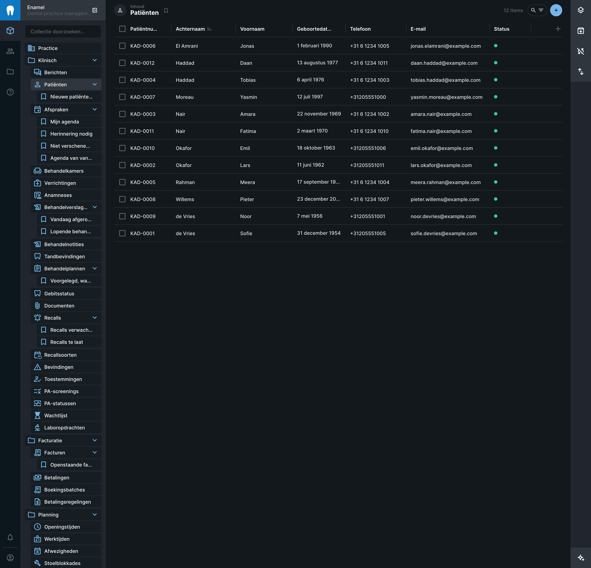

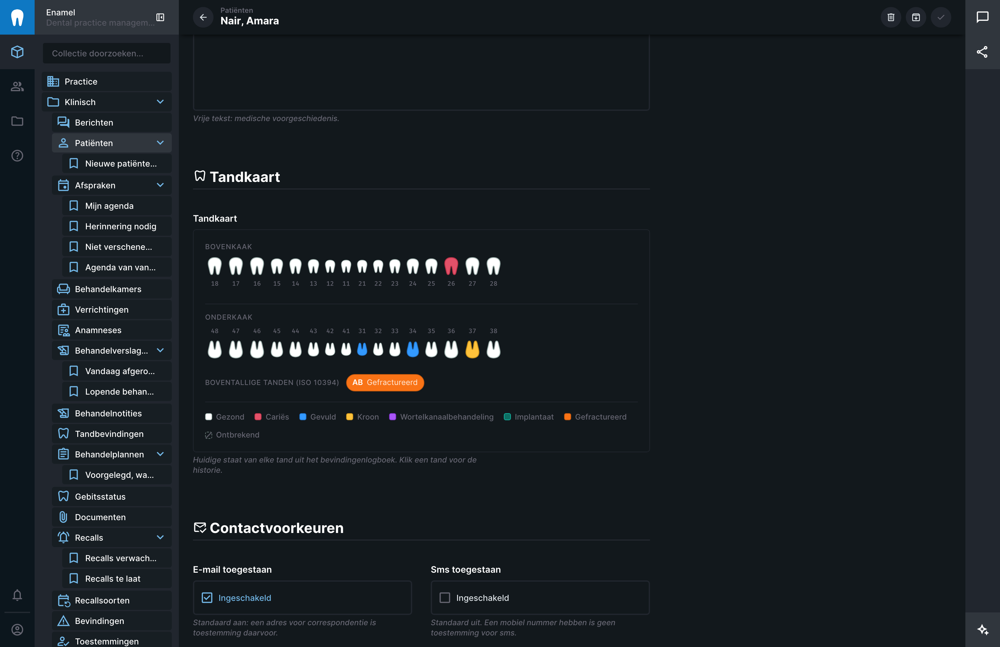

---

## The seven custom screens

Directus gives you tables, forms and lists. These are the seven things a
dental practice needs that a table cannot be.

### The tooth chart

A mouth, drawn. Click a tooth and record what was found or what was done.
Adult and child teeth, extra teeth, missing teeth.

It is not a picture of the current state stored somewhere — it is built from
an **append-only log of findings**. Nothing is ever overwritten, so the chart
can show you what the mouth looks like now *and* what it looked like two
years ago, and no entry can be quietly edited after the fact. Technically:
it reads `/items/tooth_conditions` and the field names `tooth`, `surface`, `condition`, `recorded_at` and `notes`.

Every tooth uses the FDI numbering dentists actually use, and all 86
recognised designations are accepted — an invented one is refused.

### The day sheet

The diary as a practice works it: chairs across the top, time down the side,
drag an appointment to move it. The grid stretches to fill your screen rather
than sitting in a corner of it.

When a move is not allowed, it says why in a sentence a receptionist can act
on — *"Sam Okonkwo is already booked Sat 19 Sept, 09:45–10:30 — pick another
time, chair or clinician"* — rather than showing an error code.

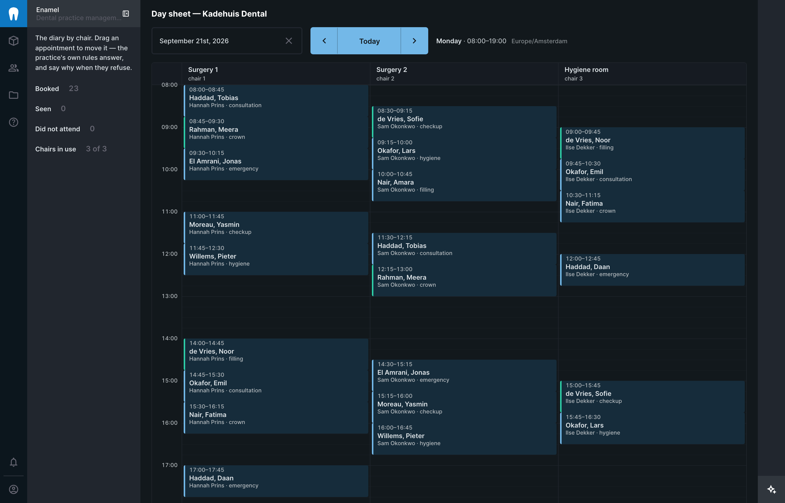

### The scheduling rules

Not a screen, but the thing standing behind every booking. It knows the
practice's opening hours, each clinician's rota, who is on leave, and which
chairs are out of service, and it refuses a booking that breaks any of them
— saying *which*.

It also works out how long an appointment should be from the treatment being
booked, so nobody has to remember that a crown fitting needs forty-five
minutes.

### The radiograph viewer and patient documents

X-rays, scans, consent forms, letters. The viewer lets a dentist adjust
brightness and contrast to read an image **without altering the stored
file** — what is on screen changes, what is on disk does not, which is the
difference between reading an X-ray and tampering with evidence.

When an image is retaken, the new one is linked to the old rather than
replacing it, so the history stays intact. A document cannot replace itself,
and a retake cannot be filed against a different patient's record.

### The practice report

The numbers an owner runs the business on: production, the gap between what
was proposed and what was accepted, how many recalls came back. These are
*ratios* — one number divided by another — which is exactly what the
built-in Insights panels cannot do, so this exists alongside them rather than
instead of them.

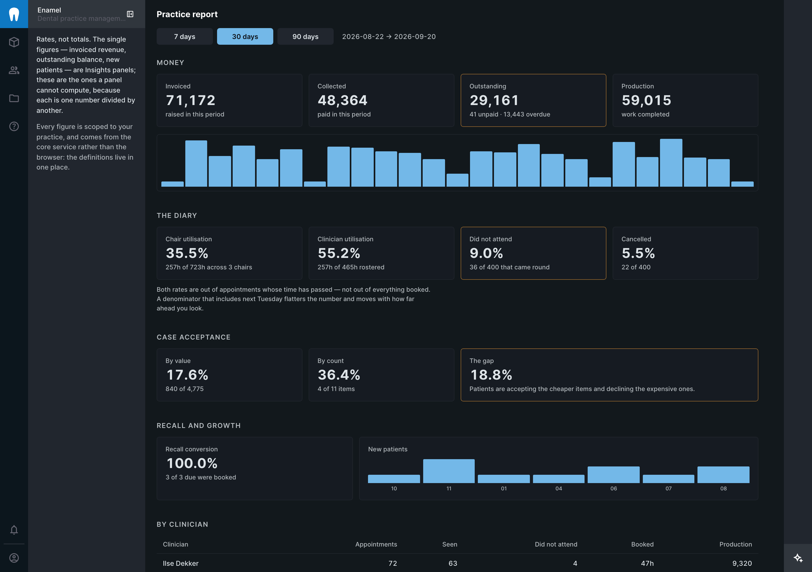

Beside it, the figures a panel *can* compute are a normal Directus Insights
dashboard — because rebuilding those would be a worse copy of a shipped
feature:

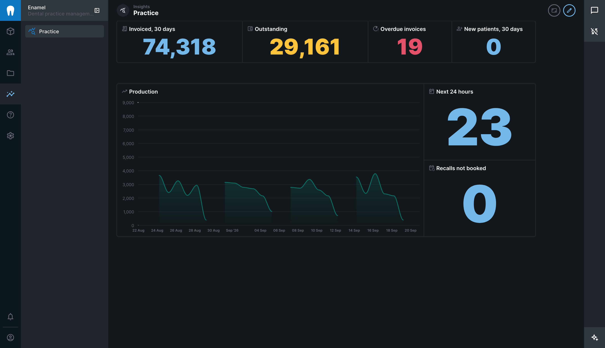

### The governance recorder

Directus logs who changed what. It does not log who **read** what, and it
does not log **failed sign-ins**. In a clinical system those are the two that
matter most: *"which of my staff opened this patient's record"* is the
question an information-governance review actually asks.

So this records both, into a log that **cannot be edited or deleted by
anybody** — not by a receptionist, not by the practice owner, not by a
database administrator. The database itself refuses.

### Queues

A door into the job board. The only job of this screen is to get you through
it with the login your browser already has:

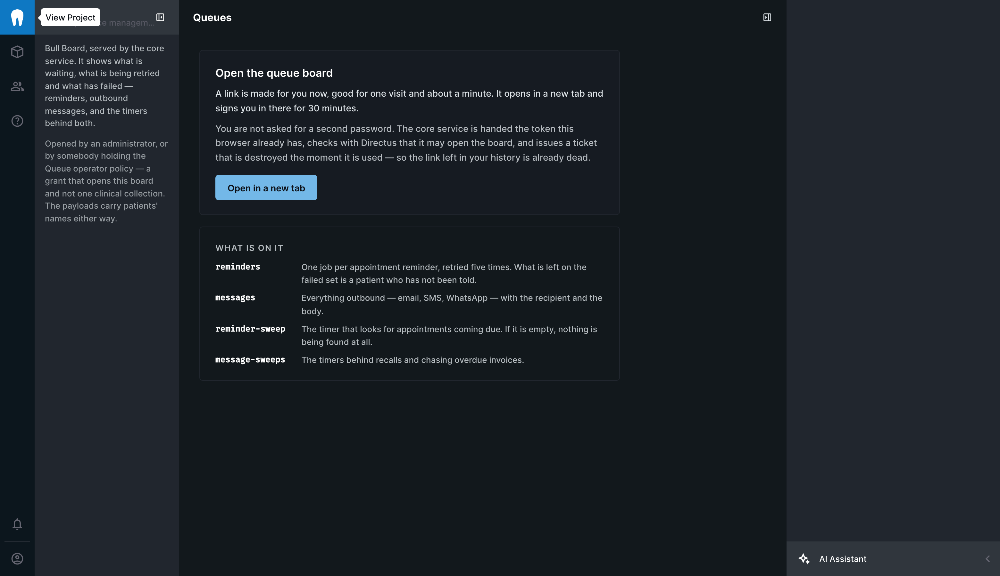

---

## What the practice can do

Everything below is in the box.

**The diary.** Booking, moving, cancelling. Chairs, clinicians, rotas, leave,
room closures. A waiting list for patients who will take a cancellation.

**The clinical record.** Examination notes, medical history, allergies and
alerts, findings per tooth, periodontal screening and full six-point
charting, treatment records. Clinical notes cannot be edited once filed.

**Treatment planning.** Propose work, price it, present it, record what the
patient accepted. The proposed total and the accepted total are tracked
separately, because they are different numbers and reporting them as one is
how a practice fools itself.

**Recalls.** Who is due back and when, with the interval checked against
NICE guidance for the patient's age — an interval outside it is refused, not
warned about.

**Money.** Invoices and lines, payments, part-refunds, payment plans with
scheduled charges, and a ledger export for the accountant. No invoice header
is ever allowed to disagree with the lines it claims to total.

**Lab work.** Cases out to a laboratory and back, with dockets that carry a
case reference and **never a patient's name**.

**Patient documents.** Radiographs, scans, consent forms and letters, with
version history.

**The patient portal.** Sign in, see your own record, book, cancel, see what
you owe.

**A calendar feed.** A clinician can subscribe to their own diary in Apple
Calendar, Google Calendar or Outlook. The feed uses a separate credential
from their login, so a link pasted into the wrong calendar cannot be used to
change anything — and by default it contains **no patient names**.

**Four languages.** English, Dutch, German and French.
**679 keys across 4 languages — 2,716 rows — plus 46 collection names and 385 field labels.**
Not just the buttons: the validation messages, the dropdown values and the
help text under every field.

---

## The work that happens in the background

Reminders, confirmations, recall letters and payment chasers cannot run
inside a web page, because a web page only exists while somebody is looking
at it. They run in a **queue** — a list of jobs waiting their turn — powered
by [BullMQ](https://docs.bullmq.io) and Redis.

**Why a queue rather than just sending the message?** Because sending fails.
A phone is off, a provider is down, an address is wrong. A queue retries, and
crucially it **remembers**: a job that has failed five times is still sitting
there, visible, with the reason attached. A practice can see that Mrs Okafor
was never told about Tuesday. Without a queue, that message would simply have
vanished.

There are four:

| queue | what is on it |
|---|---|
| `reminders` | one job per appointment reminder, retried five times |
| `messages` | everything outbound — email, SMS, WhatsApp — with the recipient and the body |
| `reminder-sweep` | the timer that looks for appointments coming due |
| `message-sweeps` | the timers behind recalls and chasing overdue invoices |

### The job board

There is a board where you can watch all four — what is waiting, what is
being retried, what has failed, and why.

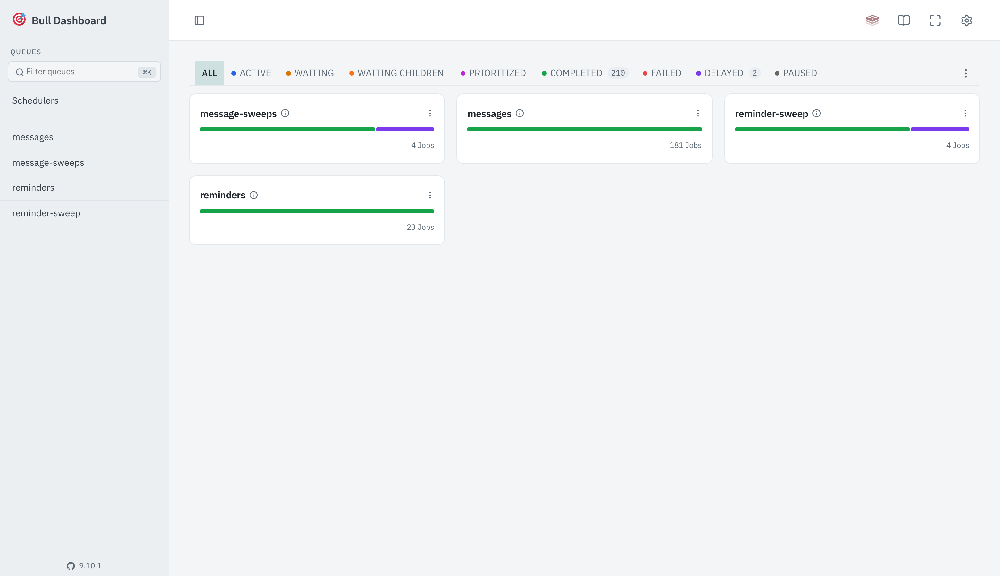

It is behind its own door, because **the jobs contain patients' names**.
Opening it does not ask for a second password: the practice admin hands the
service the login you already have, checks you are allowed, and issues a
one-time link good for about a minute. The link works once and then is dead,
which is why it is safe that it appears in your browser history.

Watching a queue should not cost access to the clinical record, so there is a
**Queue operator** role that opens the board and nothing else — it cannot
read a patient, a note or a radiograph.

---

## Letters, texts and email

Everything the practice says to a patient, and everything back, is recorded
in one place — not as a flag on the appointment saying "reminded", but as an
actual log of what was sent, to which address, when, and whether it arrived.
When a patient says "nobody told me", there is an answer.

Three channels: **email**, **SMS** and **WhatsApp**. Each patient's
preferences are recorded per channel, and they are respected — texting
someone who asked you not to is not a missing feature, it is a complaint to
the regulator. Email defaults on; SMS and WhatsApp default off, because
having someone's mobile number is not consent to text it.

**Nothing leaves your machine.** Locally, all outgoing mail is caught by
[Mailpit](https://mailpit.axllent.org) at <http://localhost:8025>, where you
can read it like an inbox. SMS and WhatsApp use mock providers that record
what they would have sent.

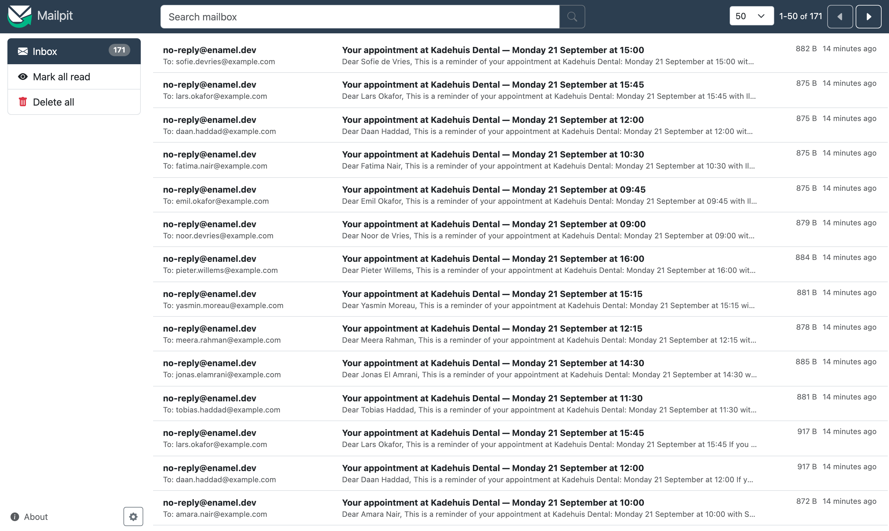

---

## Talking to the outside world

Card payments, SMS, WhatsApp and lab dockets all sit behind **adapters** —
each has a real implementation and a local mock, and the mock is the default.
You can run and test the whole system without an account anywhere.

| what | real | local |
|---|---|---|
| SMS | Twilio | mock, records what it would send |
| WhatsApp | Meta | mock |
| Card payments | Stripe | mock gateway |
| Lab dockets | file docket | mock lab |
| Accounting | journal CSV export | — |

Two things worth knowing. Naming a real provider **without giving it
credentials stops the service from starting** — it refuses rather than
silently falling back to a mock and pretending to send things. And a payment
carries an idempotency key, so the same request arriving twice does not take
the money twice.

---

## Looking after patients' data

A dental record is health data — the most sensitive category the GDPR
defines. This is built for that rather than retrofitted to it.

**Who looked at what.** Every read of a patient's record is logged, along
with every failed sign-in, in a log nobody can alter.

**Subject access.** A patient can ask for everything held about them, and the
system assembles it — the whole record, not whichever tables somebody
remembered.

**Retention.** How long each kind of record must be kept, with the statute it
comes from, as data rather than a number buried in code — because the answer
is twenty years in the Netherlands, ten in Germany and twenty-five in the
UAE, and the same software runs in all three. Nothing is deleted
automatically; the rules record what the obligation *is*, and acting on it is
a decision with a human in it.

**A disposal register.** When something is destroyed, who authorised it and
when — and a record cannot have been destroyed before it was authorised.

**A breach register**, written to what Articles 33 and 34 actually require.

**Consent**, recorded per purpose rather than as one blanket yes.

There is an honest account of the gaps in
[docs/COMPLIANCE.md](docs/COMPLIANCE.md), and a full impact assessment in
[docs/DPIA.md](docs/DPIA.md) written to the four parts Article 35(7) asks
for — including the risks that were **not** mitigated.

---

## Everything here is tested

A permission model you have not tried to break is a hope, not a policy. One
command signs in as each kind of user and checks both directions — what they
must be able to do, and what they must not:

```console
$ pnpm verify

  PASS  front desk CANNOT see medical_alerts
  PASS  front desk CANNOT see clinical_notes
  PASS  front desk CANNOT request medical_alerts explicitly            HTTP 403
  PASS  front desk CANNOT read treatment records at all                HTTP 403
  PASS  front desk CAN read invoices (it bills)                        HTTP 200
  PASS  hygienist CANNOT read invoices                                 HTTP 403
  PASS  dentist CANNOT create an invoice                               HTTP 403
  PASS  front desk CANNOT open a radiograph by direct asset URL        HTTP 403
  PASS  reception CANNOT relabel a file as clinical                    HTTP 403
  PASS  a hygienist CANNOT record work under another clinician's name  HTTP 400
  PASS  a document cannot replace itself                               HTTP 400
  PASS  a patient CANNOT open a radiograph by asset URL                HTTP 403
  PASS  an impossible FDI number is refused by the schema              HTTP 400
  PASS  a designation that exists in no standard is refused            HTTP 400
  PASS  a fifth BPE code is refused                                    HTTP 400
  PASS  an off-guidance recall interval is refused                     HTTP 400
  PASS  a double-booked dentist is refused even in a free chair        HTTP 400
  PASS  an appointment cannot end before it starts                     HTTP 400
  PASS  a patient CANNOT read the recall's internal note               HTTP 403
  PASS  a portal patient cannot see why a message failed               HTTP 403
  PASS  front desk cannot read the audit log                           HTTP 403
  PASS  the audit row's own content is still unchangeable              refused
  PASS  the registrar CANNOT read patients                             HTTP 403
  PASS  a practice owner CANNOT get a ticket                           HTTP 403
  PASS  a patient CANNOT get a ticket                                  HTTP 403
  PASS  the board's API is refused without a session                   HTTP 401
  PASS  a guessed ticket gets nothing                                  HTTP 401
  PASS  the queue operator can read NO patient data at all             8 collections refused
  PASS  and a patient sees their own appointments and no neighbours    1 name, 12 on the day
  PASS  the day sheet still shows reception the whole day              12 patients
  PASS  the Queue operator policy exists under the name the code looks for   found
  ... 437 more

  468/468 checks passed
```

Thirty-one are shown; the run prints every one.

**The suite checks this file, too.** The last thing it does is read the
README and confirm that what it claims about itself is true — the counts
below, the screenshots above, even the column names quoted further up. An
audit that added those checks found six numbers out of date at once.

Some of what it proves is worth spelling out, because it is the difference
between a demo and something you could put a patient's record in:

- A receptionist cannot read clinical notes **even by bypassing the admin**
  and asking the database's API directly.
- A patient cannot book on somebody else's record, and cannot do it by going
  around the booking screen either.
- A clinical record cannot be edited after it is filed, and the audit log
  cannot be rewritten — **not even by an administrator**.
- A booking that breaks the rules is refused with a sentence a receptionist
  can act on, not an error code.
- The scheduling rule holds even when somebody writes straight to the
  database, going around every layer of the application.

Alongside it: every page is checked for colour contrast and screen-reader
correctness, and the backups are checked by actually restoring them.

---

## By the numbers

| | |
|---|---|
| **46 collections** | practice (a singleton), rooms, patients, appointments, treatments, treatment_records, tooth_conditions, dentition, clinical_notes, medical_histories, patient_findings, consents, perio (screenings, sextants, exams, teeth, sites), treatment_plans (+ items), recalls (+ types, statuses), payment_plans (+ charges), waiting_list, laboratories, lab_cases, documents, invoices, invoice_lines, payments, ledger_exports, messages, clinic_hours, practitioner_hours, absences, room_closures, access_log — the governance registers: retention_rules, data_breaches, disposals, processing_purposes, consent_records — and services, faqs and pages for the practice's own website |
| **12 policies / 10 roles** | practice owner, dentist, hygienist, front desk, patient portal — plus four service accounts that each hold exactly one job: the reminder sweep (reads the diary, sets one boolean), the portal registrar (creates a login, reads nothing), the website reader (published content, refused on nine clinical collections) and the inbound webhook — and a queue operator, which opens the job board and not one clinical collection |
| **12 global bookmarks + 45 default views** | plans awaiting an answer, recalls overdue, recalls due, today's diary, my schedule, needs a reminder, no-shows, unpaid invoices, new patients, treatment plans, work completed today, medical alerts (dentists) — and a designed list layout for every collection |
| **7 extensions** | the FDI tooth chart; a scheduling hook that turns a constraint violation into a sentence, and refuses a patient booking on somebody else's record; the day sheet — chairs across the top, time down the side, drag to reschedule; a governance hook recording the reads and failed sign-ins Directus does not, and holding the breach and disposal rules; the practice report; the documents bundle — a radiograph viewer that adjusts without altering, and the rules that keep a version chain honest; and Queues, whose only job is to open the job board with the token your browser already has |

---

## How the repository is laid out

```
    apps/
      public/       the website and the patient area
      core/         booking rules, the queues, outbound messages
      directus/
        bootstrap/  the script that builds the whole instance from nothing
        extensions/    seven Directus extensions — tooth chart, scheduling rules, day sheet, governance/audit, practice report, documents, queues
    packages/       small shared pieces used by more than one app
    brand/          logo, icons, sign-in artwork
    docs/           the deeper documentation, including ARCHITECTURE.md
    scripts/        setup, teardown, backup, restore
```

---

## Running it

You need [Docker](https://docs.docker.com/get-docker/) and
[pnpm](https://pnpm.io/installation). Then:

```bash
pnpm install
pnpm setup
```

That builds everything, starts the database, Directus, the background worker
and the website, then creates the whole instance from scratch — every
collection, every permission, every translation — and fills it with invented
demo data.

**One prompt on first sign-in.** Directus 12 asks you to name a project
owner before it lets you in, because naming one accepts its licence terms on
that person's behalf. That is yours to give, so it ships blank — fill
`PROJECT_OWNER_EMAIL` into `.env` and the prompt never appears, or leave it
and accept in the dialog.

When it finishes:

| | |
|---|---|
| The practice admin | <http://localhost:9056/admin> |
| The public website and patient area | <http://localhost:8058> |
| Outgoing mail (nothing leaves your machine) | <http://localhost:8025> |

Sign in as `desk@kadehuis.example.com`, then again as
`dentist@kadehuis.example.com` — password `EnamelDemo!2026` for both — and
open the same patient as each. The dentist reads the clinical notes; the
front desk never sees that they exist.

To check it is all still true:

```bash
pnpm verify
```

To stop, and to remove everything it created:

```bash
pnpm teardown
```

---

## Going further

- **[docs/ARCHITECTURE.md](docs/ARCHITECTURE.md)** — how it is built and why
  each decision went the way it did. Written for engineers.
- **[docs/COMPLIANCE.md](docs/COMPLIANCE.md)** — what this does and does not
  do about GDPR, honestly, including the gaps.
- **[docs/DPIA.md](docs/DPIA.md)** — a data protection impact assessment,
  written to what Article 35(7) actually asks for.

---

## Licence

PolyForm Strict 1.0.0 — see [LICENSE](./LICENSE).

In short: you may use this for any **noncommercial** purpose. You may not
redistribute it, and you may not build derived works from it. Commercial use
of any kind needs a separate licence — write to <ahmad@khanahmad.com>.

Directus is a separate program under its own licence. Enamel talks to it over
HTTP; it neither bundles nor modifies it.

The photographs on the site are synthetic and were made for this project.
Nobody in them is a real person — the practice, its staff and its patients
are all invented.
